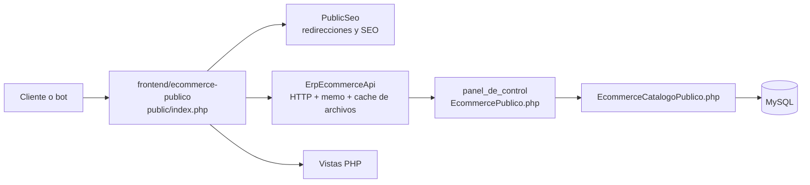

# Revision tecnica Artiani

Fecha: 2026-11-06

## Alcance

Revision local de la tienda publica y la API/ERP, con enfasis en llamadas internas, cache, salud, POO, consultas y controles de seguridad. No se consultaron credenciales ni se ejecutaron escrituras sobre la base productiva.

## Arquitectura actual verificada

La tienda es PHP propio, sin WordPress ni framework externo identificado. `public/index.php` crea `ErpEcommerceApi`, ejecuta `PublicSeo` y resuelve rutas HTML y JSON. `render_page()` compone datos globales y vistas. El ERP es otra aplicacion PHP MVC: `EcommercePublico.php` coordina contratos publicos y `EcommerceCatalogoPublico.php` consulta MySQL y arma las respuestas.

## Secuencia de pagina publica

1. `public/index.php` crea el cliente API.
2. `PublicSeo::handle()` puede consultar redirecciones antes del cache HTML.
3. `render_cached_page()` sirve HTML si `APP_PAGE_CACHE_SECONDS` lo permite; por defecto es 0.
4. `render_page()` solicita navegacion, categorias, politicas, configuracion y configuracion inicial.
5. La pagina agrega sus dependencias: estado, SEO, CMS, catalogo, filtros o producto.
6. `ErpEcommerceApi::request()` reutiliza memoria, cache de archivo o hace HTTP al ERP.

Con cache frio, las llamadas logicas de una pagina pueden superar las transferencias HTTP reales porque algunas se reutilizan en memoria o en cache. La prueba anterior de 8 transferencias correspondio a una secuencia de endpoints representativa, no a una pagina completa. La estimacion de 11-13 corresponde a una pagina completa con SEO, globales y dependencias especificas; no son mediciones equivalentes.

## Cache vencida y concurrencia

Antes de esta revision, la coordinacion fuerte existia para algunas rutas SEO y para configuracion inicial, pero no para el cache API general. Se implemento un bloqueo por URL en `ErpEcommerceApi::request()` para GET cacheables. El bloqueo espera como maximo 0.25 segundos por defecto, vuelve a leer el cache despues de adquirirlo y libera el recurso en `finally`.

Si otra peticion esta regenerando y existe una respuesta anterior, se entrega como obsoleta y marcada. Si no existe respuesta anterior, se devuelve 503 controlado. Esto evita anunciar exito falso y limita la repeticion inmediata de una consulta costosa.

## Salud

`/api/health` ahora es una comprobacion basica local y no consulta el ERP. El diagnostico profundo se conserva en `/api/health?deep=1` y `/api/health/deep`. La pagina interna de estado usa el modo profundo de forma explicita.

## Limites de confianza

- Cliente publico -> frontend: URL, query string, cookies y POSTs publicos; deben validarse y escaparse segun contexto.
- Frontend -> ERP: destino configurado por servidor, no por entrada publica; respuestas externas no se consideran confiables solo por ser internas.
- ERP -> MySQL: consultas parametrizadas cuando hay entrada variable; las consultas publicas revisadas usan listas y valores controlados, pero requieren plan de ejecucion para optimizacion.
- Sesiones y permisos: pertenecen principalmente al ERP; esta revision no certifica todos los controladores autenticados.

## Componentes y oportunidades

| Componente | Responsabilidad | Efecto externo | Oportunidad |
|---|---|---|---|
| `public/index.php` | Entrada y rutas | Render, JSON | Mantener salud basica separada |
| `app/Api/ErpEcommerceApi.php` | HTTP, memo, cache, errores | Red y archivos | Coordinar regeneracion por clave |
| `app/helpers.php` | Composicion global | Multiples llamadas API | Reducir duplicados y dependencias implicitas |
| `app/Domain/Seo.php` | SEO y redirecciones | Consulta SEO | Mantener cache separado |
| `EcommercePublico.php` | Contrato publico ERP | Respuestas JSON | Medir tiempos por endpoint |
| `EcommerceCatalogoPublico.php` | Persistencia y calculos | MySQL | Medir SQL antes de optimizar |

